<div align="center">


# 🎓 Smart Campus Complaint Portal

### A modern campus complaint management system — report, track and resolve campus issues in one place.

<br/>

[](https://student-complaint-01.lovable.app)
[](https://github.com/your-username/smart-campus-complaint-portal/stargazers)
[](LICENSE)
[](https://github.com/your-username/smart-campus-complaint-portal/releases)

[](https://react.dev)
[](https://typescriptlang.org)
[](https://tailwindcss.com)
[](https://postgresql.org)
[](#-contributing)

</div>

---

## 🌐 Live Demo

<div align="center">

### Try the live website here 👇

<a href="https://student-complaint-01.lovable.app">
  
</a>

<br/><br/>

| Area                   | URL                                                  |
| :--------------------- | :--------------------------------------------------- |
| 🎓 Student portal      | https://student-complaint-01.lovable.app             |
| 🛡️ Staff / admin login | https://student-complaint-01.lovable.app/admin/login |

</div>

---

## 📸 A Look Inside — Website Trailer

<div align="center">

<b>🏠 Home — bento dashboard, live activity and quick complaint entry</b>

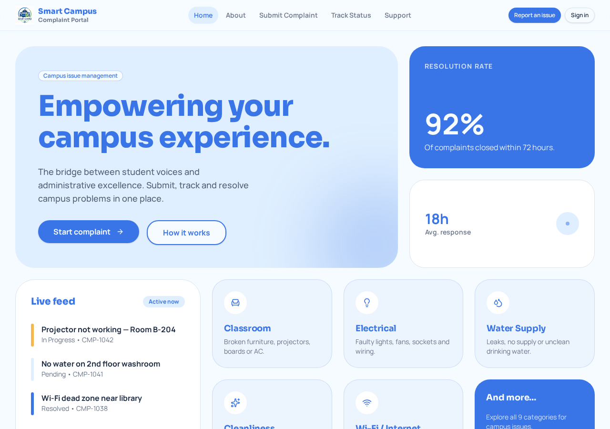

</div>

<table>
  <tr>
    <td width="50%"><b>🔐 Student Login</b><br/>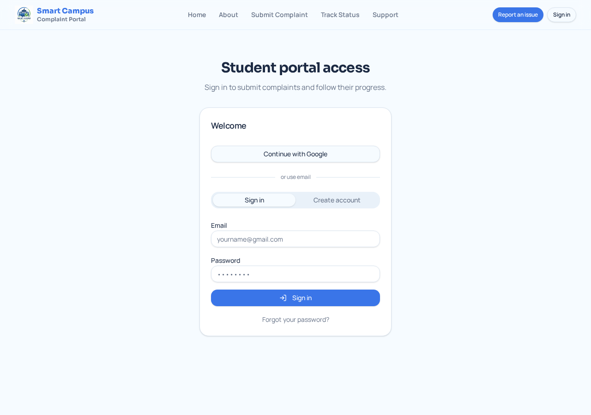</td>
    <td width="50%"><b>🛡️ Staff / Admin Login</b><br/>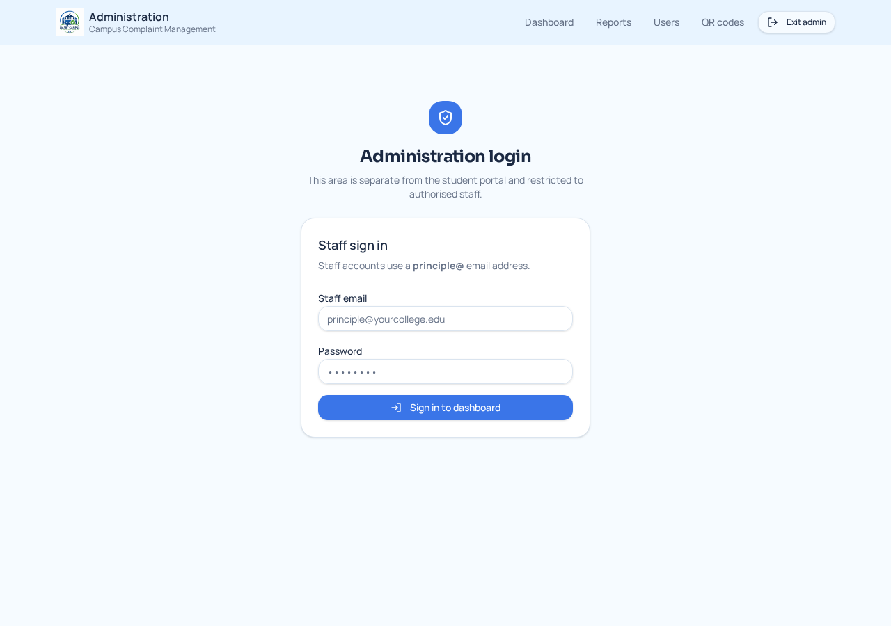</td>
  </tr>
  <tr>
    <td width="50%"><b>ℹ️ About the Portal</b><br/>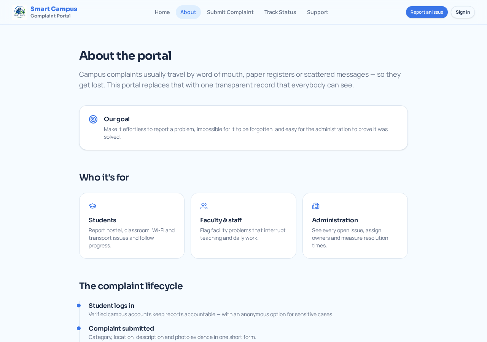</td>
    <td width="50%"><b>🎧 Support & Help Desk</b><br/>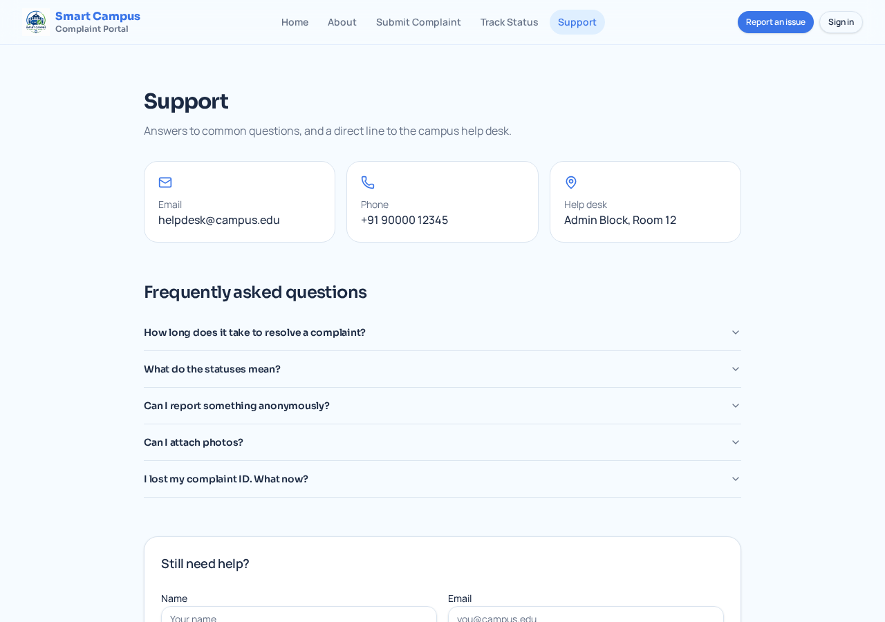</td>
  </tr>
</table>

<div align="center">

<b>🛡️ Admin Dashboard — Review, assign & resolve complaints</b>

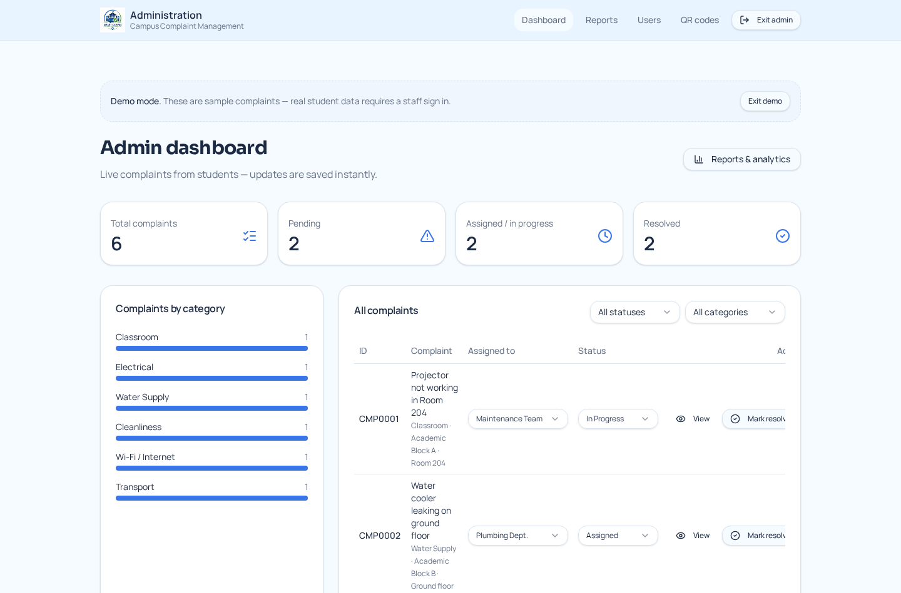

</div>

<table>
  <tr>
    <td width="50%"><b>📊 Reports & Analytics</b><br/>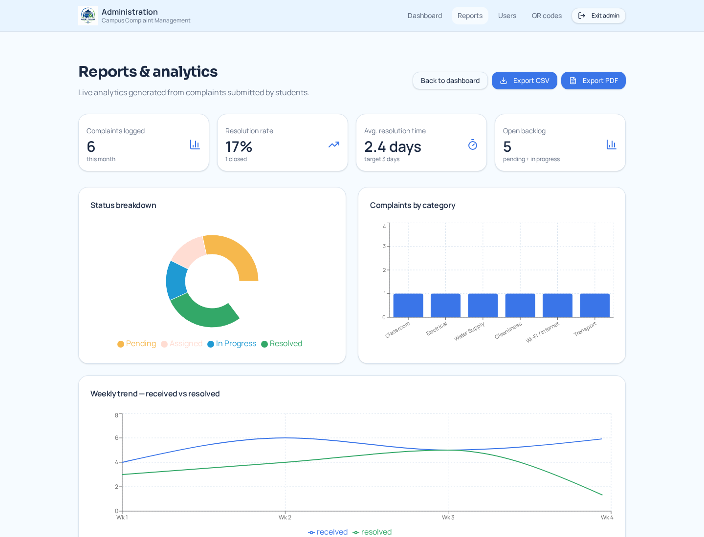</td>
    <td width="50%"><b>🔍 Track Complaint Status</b><br/>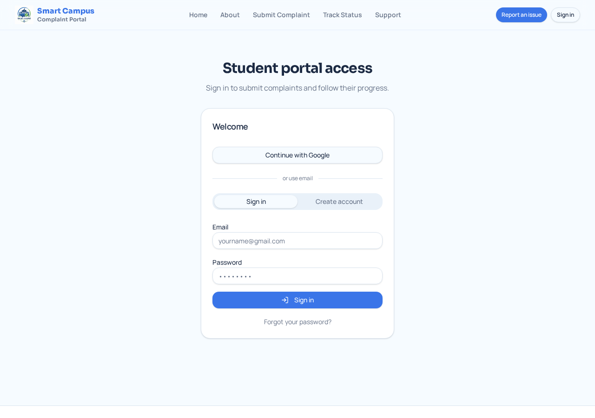</td>
  </tr>
</table>

<div align="center">

🔒 The complaint submission form, full tracking timeline, admin dashboard and analytics live behind login —
<a href="https://student-complaint-01.lovable.app"><b>sign in on the live site</b></a> to see them in action.

</div>

---

## ✨ Features

<table>
  <tr>
    <td width="33%">
      <h3>🔐 Authentication</h3>
      Email / password + Google sign-in, secure sessions, password reset by email.
    </td>
    <td width="33%">
      <h3>📝 Complaint Tracking</h3>
      Sequential IDs (<code>CMP0001</code>) with a full status-history timeline.
    </td>
    <td width="33%">
      <h3>🛡️ Admin Dashboard</h3>
      Separate protected area to review, assign and resolve every complaint.
    </td>
  </tr>
  <tr>
    <td>
      <h3>📈 Analytics</h3>
      KPI cards, pie / bar / line charts, CSV and PDF export for stakeholders.
    </td>
    <td>
      <h3>🔔 Notifications</h3>
      In-app alerts on every status change; admins are pinged on new complaints.
    </td>
    <td>
      <h3>📱 Responsive Design</h3>
      Mobile-first layouts — the admin table turns into stacked cards on phones.
    </td>
  </tr>
  <tr>
    <td>
      <h3>🌗 Theming</h3>
      Token-driven design system with light theme and dark-mode ready tokens.
    </td>
    <td>
      <h3>🖼️ File Upload</h3>
      Photo evidence stored in a private bucket, visible to the owner and admins only.
    </td>
    <td>
      <h3>🔎 Search & Filters</h3>
      Filter by category, status, priority and date; punctuation-insensitive search.
    </td>
  </tr>
  <tr>
    <td>
      <h3>🚦 Status Lifecycle</h3>
      Pending → Assigned → In Progress → Resolved, logged automatically.
    </td>
    <td>
      <h3>🔒 Secure APIs</h3>
      Typed server functions, Row Level Security and role-based policies.
    </td>
    <td>
      <h3>🎨 Modern UI</h3>
      Bento-grid layout, shadcn/ui components, Sora + Manrope typography.
    </td>
  </tr>
</table>

<details>
<summary><b>🤖 Smart extras</b></summary>

- **AI auto-categorisation** — suggests category and priority from the complaint text.
- **QR reporting** — printable location posters that pre-fill the complaint form.
- **Admin provisioning** — the college creates staff accounts (name, email, department, phone, password); students can never self-register as admins.
- **User management** — grant or revoke the admin role from the admin panel.
- **Feedback loop** — students rate the resolution; ratings feed the analytics.
- **Demo mode** — an _Open demo dashboard (no login)_ button on `/admin/login` opens the admin dashboard and reports with sample complaints, so reviewers can explore the workflow without credentials. Real student data still requires a staff sign-in.

</details>

---

## 🧰 Tech Stack

| Layer               | Technology                                                |
| :------------------ | :-------------------------------------------------------- |
| **Frontend**        | React 19 + TanStack Start (SSR) + TanStack Router         |
| **Backend**         | TypeScript server functions (edge runtime)                |
| **Database**        | PostgreSQL with Row Level Security                        |
| **Authentication**  | Managed auth — email/password, Google OAuth, JWT sessions |
| **Storage**         | Private object storage bucket for complaint photos        |
| **Hosting**         | Lovable Cloud (edge deployment + CDN)                     |
| **Version Control** | Git + GitHub                                              |
| **Deployment**      | Continuous deploy on push / one-click publish             |
| **UI Framework**    | Tailwind CSS v4 + shadcn/ui + Radix primitives            |
| **Icons**           | Lucide React                                              |
| **Animations**      | Tailwind CSS animations + Radix transitions               |
| **Charts / Export** | Recharts, jsPDF + jspdf-autotable                         |
| **AI**              | Lovable AI Gateway (Gemini 2.5 Flash)                     |

---

## 🏗️ Architecture

The app is a single full-stack TypeScript project. The React frontend renders on the edge, calls typed server functions, and every database read/write is enforced by Row Level Security so the policy layer — not the client — decides what a user can see.

```text
Frontend (React + TanStack Router)
        ↓
Server Functions (typed RPC on the edge)
        ↓
Authentication (JWT session + role check)
        ↓
Database (PostgreSQL + RLS policies)
        ↓
Storage (private complaint-photos bucket)
        ↓
Notifications (DB triggers → in-app alerts)
```

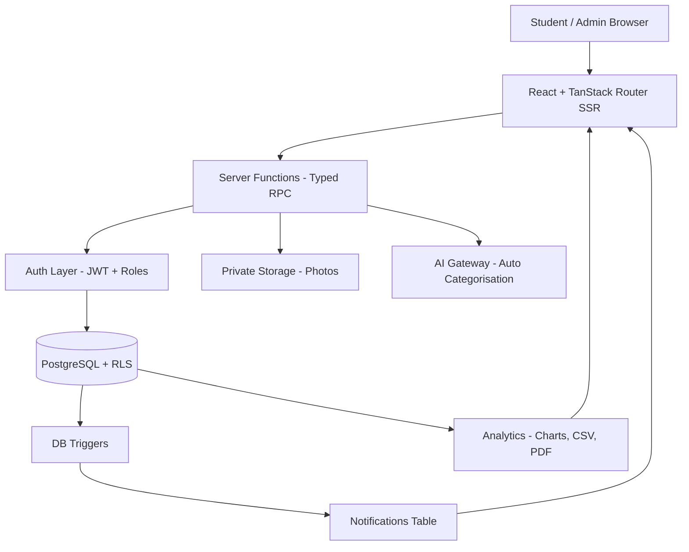

---

## 📁 Project Structure

```text
smart-campus-complaint-portal/
├── public/                     # Static assets, favicon
├── docs/
│   └── screenshots/            # README images
├── src/
│   ├── assets/                 # Logo, campus imagery
│   ├── components/             # Reusable UI
│   │   ├── ui/                 # shadcn/ui primitives
│   │   ├── SiteHeader.tsx
│   │   ├── SiteFooter.tsx
│   │   └── AdminHeader.tsx
│   ├── hooks/                  # Custom React hooks
│   ├── lib/                    # Helpers, server functions, types
│   ├── integrations/           # Backend client + generated types
│   ├── routes/                 # File-based routes (pages + APIs)
│   │   ├── index.tsx           # Home
│   │   ├── about.tsx
│   │   ├── auth.tsx            # Student login
│   │   ├── submit.tsx          # Complaint form
│   │   ├── track.tsx           # My complaints
│   │   ├── support.tsx
│   │   ├── reset-password.tsx
│   │   ├── admin.login.tsx
│   │   ├── admin.dashboard.tsx
│   │   ├── admin.reports.tsx
│   │   ├── admin.users.tsx
│   │   └── admin.qr.tsx
│   ├── styles.css              # Design tokens + Tailwind theme
│   └── router.tsx
├── supabase/                   # SQL migrations (schema, RLS, triggers)
├── .env                        # Environment variables
├── package.json
└── vite.config.ts
```

---

## ⚙️ Installation

<details open>
<summary><b>1 · Clone the repository</b></summary>

```bash
git clone https://github.com/your-username/smart-campus-complaint-portal.git
cd smart-campus-complaint-portal
```

</details>

<details open>
<summary><b>2 · Install dependencies</b></summary>

```bash
npm install
```

</details>

<details open>
<summary><b>3 · Configure environment variables</b></summary>

```bash
cp .env.example .env
# then fill in the values (see the next section)
```

</details>

<details open>
<summary><b>4 · Set up the database</b></summary>

Run the SQL migrations in `supabase/migrations/` against your PostgreSQL instance, in filename order. They create the enums, tables, RLS policies, GRANTs, triggers and the storage bucket.
</details>

<details open>
<summary><b>5 · Run the app</b></summary>

```bash
npm run dev      # frontend + server functions on http://localhost:8080
npm run build    # production build
npm run preview  # preview the production build
```

> This is a full-stack framework — the frontend and the backend server functions run from the same dev command.

</details>

---

## 🔑 Environment Variables

```env
# ---- Public (browser-safe) ----
VITE_SUPABASE_URL=https://your-project.supabase.co
VITE_SUPABASE_PUBLISHABLE_KEY=your_publishable_key
VITE_SUPABASE_PROJECT_ID=your_project_id

# ---- Server-only (never expose to the client) ----
LOVABLE_API_KEY=your_ai_gateway_key
```

| Variable                        | Required | Description                                |
| :------------------------------ | :------: | :----------------------------------------- |
| `VITE_SUPABASE_URL`             |    ✅    | Backend project URL                        |
| `VITE_SUPABASE_PUBLISHABLE_KEY` |    ✅    | Public anon key used by the browser client |
| `VITE_SUPABASE_PROJECT_ID`      |    ✅    | Project identifier                         |
| `LOVABLE_API_KEY`               |    ➖    | Enables AI auto-categorisation             |

---

## 🔌 API Endpoints

App-internal calls use typed server functions; the table below lists their logical endpoints.

|  Method  | Endpoint                       | Description                                                             |    Access     |
| :------: | :----------------------------- | :---------------------------------------------------------------------- | :-----------: |
|  `POST`  | `/auth/signup`                 | Register a student account                                              |    Public     |
|  `POST`  | `/auth/login`                  | Sign in with email / Google                                             |    Public     |
|  `POST`  | `/auth/reset-password`         | Send a password-reset email                                             |    Public     |
|  `GET`   | `/api/complaints`              | List the signed-in user's complaints                                    |    Student    |
|  `POST`  | `/api/complaints`              | Create a complaint (+ photo upload)                                     |    Student    |
| `DELETE` | `/api/complaints/:id`          | Withdraw a complaint                                                    |     Owner     |
|  `GET`   | `/api/complaints/:id/history`  | Status-history timeline                                                 | Owner / Admin |
|  `POST`  | `/api/complaints/:id/feedback` | Submit feedback after resolution                                        |     Owner     |
|  `POST`  | `/api/ai/categorise`           | Suggest category + priority from text                                   |    Student    |
|  `GET`   | `/api/notifications`           | Fetch in-app notifications                                              |     Auth      |
|  `GET`   | `/api/admin/complaints`        | All complaints with filters                                             |     Admin     |
| `PATCH`  | `/api/admin/complaints/:id`    | Update status / assignee                                                |     Admin     |
|  `GET`   | `/api/admin/reports`           | Aggregated analytics data                                               |     Admin     |
|  `GET`   | `/api/admin/users`             | List users and roles                                                    |     Admin     |
|  `POST`  | `/api/admin/users/:id/role`    | Grant or revoke the admin role                                          |     Admin     |
|  `POST`  | `/api/admin/users`             | Create a staff/admin account (name, email, department, phone, password) |     Admin     |

---

## 🛡️ Admin Account Creation

Admin accounts are **issued by the college**, never self-registered. Every public sign-up
becomes a student; only an existing admin can create another admin from `/admin/users`.

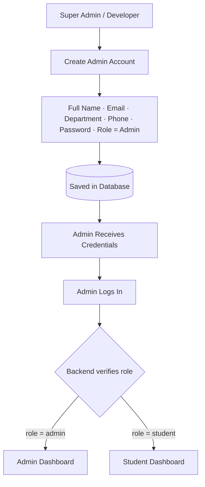

| #   | Name                | Email                   | Department       | Role    |
| :-- | :------------------ | :---------------------- | :--------------- | :------ |
| 1   | Principal           | principal@college.edu   | Administration   | Admin   |
| 2   | HOD CSE             | hod.cse@college.edu     | Computer Science | Admin   |
| 3   | Maintenance Officer | maintenance@college.edu | Maintenance      | Admin   |
| 4   | Nishanth            | nishanth@college.edu    | Student          | Student |

> Sign-in is role-aware: the same login form routes admins to `/admin/dashboard` and
> students to their own tracking area. Students cannot change their own role.

---

## 🗄️ Database Schema

<details open>
<summary><b>View all tables</b></summary>

### `profiles` — Users

| Column       | Type        | Notes                           |
| :----------- | :---------- | :------------------------------ |
| `id`         | uuid        | PK, references the auth user    |
| `full_name`  | text        | Display name                    |
| `email`      | text        | Contact email                   |
| `department` | text        | Department (staff accounts)     |
| `phone`      | text        | Contact number (staff accounts) |
| `created_at` | timestamptz | Sign-up time                    |

### `user_roles` — Admins & roles

| Column    | Type | Notes                |
| :-------- | :--- | :------------------- |
| `id`      | uuid | PK                   |
| `user_id` | uuid | FK → auth user       |
| `role`    | enum | `admin` \| `student` |

> Roles live in their own table and are checked by a `SECURITY DEFINER` `has_role()` function — never stored on the profile, to prevent privilege escalation.

### `complaints`

| Column                     | Type        | Notes                                                                                  |
| :------------------------- | :---------- | :------------------------------------------------------------------------------------- |
| `id`                       | uuid        | PK                                                                                     |
| `reference`                | text        | Sequential ID, e.g. `CMP0001`                                                          |
| `user_id`                  | uuid        | Reporter                                                                               |
| `category`                 | enum        | Classroom, Electrical, Water, Cleanliness, Wi-Fi, Transport, Hostel, Library, Security |
| `priority`                 | enum        | Low / Medium / High                                                                    |
| `title`, `description`     | text        | Complaint content                                                                      |
| `location`                 | text        | Block / room / campus point                                                            |
| `photos`                   | text[]      | Storage paths (private bucket)                                                         |
| `status`                   | enum        | Pending / Assigned / In Progress / Resolved                                            |
| `assigned_to`              | text        | Department or staff member                                                             |
| `created_at`, `updated_at` | timestamptz | Timestamps                                                                             |

### `complaint_status_history` — Departments & workflow log

| Column                     | Type        | Notes            |
| :------------------------- | :---------- | :--------------- |
| `id`                       | uuid        | PK               |
| `complaint_id`             | uuid        | FK → complaints  |
| `from_status`, `to_status` | enum        | Transition       |
| `changed_by`               | uuid        | Actor            |
| `note`                     | text        | Optional remark  |
| `created_at`               | timestamptz | When it happened |

### `complaint_feedback`

| Column         | Type | Notes           |
| :------------- | :--- | :-------------- |
| `id`           | uuid | PK              |
| `complaint_id` | uuid | FK → complaints |
| `rating`       | int  | 1–5             |
| `comment`      | text | Free text       |

### `notifications`

| Column          | Type        | Notes      |
| :-------------- | :---------- | :--------- |
| `id`            | uuid        | PK         |
| `user_id`       | uuid        | Recipient  |
| `title`, `body` | text        | Message    |
| `read`          | boolean     | Read state |
| `created_at`    | timestamptz | Timestamp  |

</details>

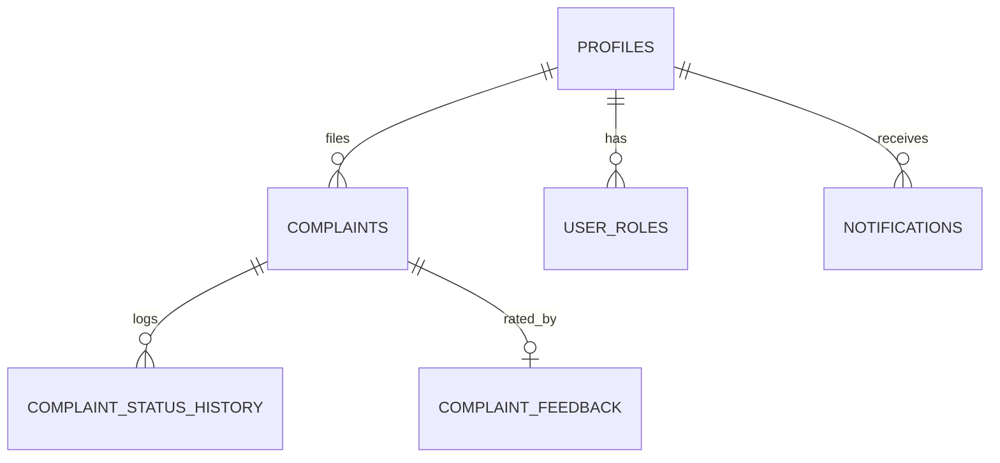

---

## 🔄 Workflow

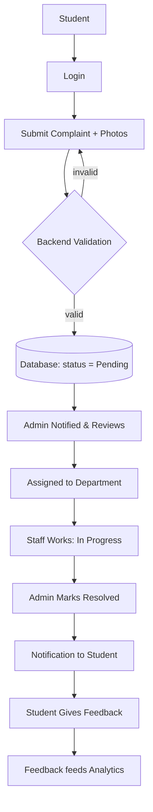

---

## 🧪 Technologies Used — and why

| Technology                        | Why it was chosen                                                                            |
| :-------------------------------- | :------------------------------------------------------------------------------------------- |
| **React 19**                      | Mature component model, huge ecosystem, concurrent rendering for a snappy UI.                |
| **TanStack Start**                | Full-stack React with SSR and typed server functions — one language, no separate API server. |
| **TypeScript**                    | End-to-end type safety from database rows to UI props; catches bugs before runtime.          |
| **PostgreSQL**                    | Relational integrity for complaints, roles and history, plus RLS for per-row authorisation.  |
| **Row Level Security**            | Authorisation lives in the database, so a client bug can never leak another student's data.  |
| **JWT sessions**                  | Stateless, standard auth that works cleanly on an edge runtime.                              |
| **Tailwind CSS v4**               | Token-driven design system, no dead CSS, effortless responsive work.                         |
| **shadcn/ui + Radix**             | Accessible, unstyled primitives we own and theme — not a rigid component library.            |
| **Recharts**                      | Declarative React charts for the analytics dashboard.                                        |
| **jsPDF**                         | Client-side PDF report generation with no server rendering cost.                             |
| **Lucide Icons**                  | Consistent, lightweight, tree-shakeable icon set.                                            |
| **AI Gateway (Gemini 2.5 Flash)** | Fast, cheap classification for auto-categorising complaints.                                 |
| **Lovable Cloud**                 | Managed Postgres, auth, storage and edge hosting with one-click deploys.                     |
| **GitHub**                        | Version control, issues, PR reviews and CI.                                                  |

---

## ⚡ Performance

- 🚀 **Fast loading** — server-side rendering + edge delivery for a quick first paint
- 📱 **Responsive** — fluid grid layouts, no layout shift between breakpoints
- 🔍 **SEO optimised** — per-route titles, meta descriptions, Open Graph and semantic HTML
- 💤 **Lazy loading** — route-level code splitting and deferred images
- 🖼️ **Optimised images** — compressed assets served through a CDN
- 🧠 **Caching** — query caching and prefetching on hover for instant navigation

---

## 🔐 Security

| Control                   | Implementation                                                                    |
| :------------------------ | :-------------------------------------------------------------------------------- |
| 🔑 **JWT authentication** | Signed, expiring session tokens attached to every server call                     |
| 🧂 **Password hashing**   | Managed auth hashes and salts credentials — plaintext is never stored             |
| ✅ **Input validation**   | Schema validation on every server function before it touches the database         |
| 👥 **Role-based access**  | Roles in a dedicated table, checked by a `SECURITY DEFINER` `has_role()` function |
| 🚧 **Protected routes**   | Student and admin areas gated client- and server-side                             |
| 🗂️ **Private storage**    | Complaint photos are only readable by the owner and admins                        |
| 🔒 **HTTPS ready**        | TLS everywhere, secure cookies in production                                      |
| 🛡️ **RLS on every table** | Deny-by-default policies; no table is reachable without an explicit policy        |

---

## 📱 Responsive Design

| Device         | Breakpoint   | Experience                                                                |
| :------------- | :----------- | :------------------------------------------------------------------------ |
| 🖥️ **Desktop** | ≥ 1280px     | Full bento grid, multi-column dashboard and side-by-side charts           |
| 💻 **Tablet**  | 768 – 1279px | Two-column layout, condensed tables, condensed filters                    |
| 📱 **Mobile**  | < 768px      | 2-up KPI cards, card-based complaint list, full-width filters and actions |

**On phones the admin area re-flows instead of shrinking:**

- the admin nav scrolls horizontally rather than clipping off-screen
- KPI / stat cards drop to a tidy 2-column grid with smaller type
- the complaints table is replaced by stacked cards — title, status badge, assign + status pickers, and _View_ / _Resolve_ buttons
- filters, export (CSV / PDF) and CTA buttons stretch full width for thumb-friendly tap targets

---

## 🚧 Future Improvements

- [ ] 🤖 Deeper AI complaint classification and duplicate detection
- [ ] 📧 Email notifications on every status change
- [ ] 🔔 Web push notifications
- [ ] 📷 Expanded QR complaint reporting across campus points
- [ ] 💬 Live chat support with the help desk
- [ ] ⚡ Real-time updates via subscriptions
- [ ] 📊 Department-level analytics dashboard and SLA tracking
- [ ] 🕵️ Anonymous complaint option

---

## 🤝 Contributing

Contributions make the open-source community amazing. Every PR is welcome!

<details open>
<summary><b>Contribution steps</b></summary>

1. **Fork** the repository
2. **Create a branch** — `git checkout -b feature/amazing-feature`
3. **Commit your changes** — `git commit -m "feat: add amazing feature"`
4. **Push the branch** — `git push origin feature/amazing-feature`
5. **Open a Pull Request** describing what changed and why

**Guidelines**

- Follow the existing code style; run `npm run lint` before pushing
- Use [Conventional Commits](https://www.conventionalcommits.org/) (`feat:`, `fix:`, `docs:`, `chore:`)
- Keep PRs focused — one feature or fix per PR
- Add screenshots for any UI change
- Open an issue first for large features so we can align on the approach

</details>

---

## 📄 License

Distributed under the **MIT License**. See [`LICENSE`](LICENSE) for details.

```text
MIT License © 2026 NISHANTH B
```

---

## 👨‍💻 Author

<table>
  <tr>
    <td align="center" width="180">
      <br/>
      <b>NISHANTH B</b><br/>
      <sub>Full-Stack Developer</sub>
    </td>
    <td>
      <p>Built the Smart Campus Complaint Portal end-to-end — design system, frontend, database schema and admin analytics.</p>
      <a href="https://linkedin.com/in/your-profile"></a>
      <a href="https://github.com/your-username"></a>
      <a href="https://your-portfolio.com"></a>
      <a href="mailto:you@example.com"></a>
    </td>
  </tr>
</table>

---

## 💖 Support

If this project helped you or you like what you see:

- ⭐ **Star** this repository
- 🍴 **Fork** it and build your own campus portal
- 🐞 **Report bugs** in [Issues](https://github.com/your-username/smart-campus-complaint-portal/issues)
- 💡 **Request features** in [Discussions](https://github.com/your-username/smart-campus-complaint-portal/discussions)

<div align="center">

### ⭐ Star the repo — it genuinely helps!

[](https://star-history.com/#your-username/smart-campus-complaint-portal&Date)

</div>

---

<div align="center">

Made with ❤️ by **NISHANTH B**

<a href="https://student-complaint-01.lovable.app"><b>🌐 Live Website</b></a> ·
<a href="#-features"><b>Features</b></a> ·
<a href="#-installation"><b>Install</b></a> ·
<a href="#-contributing"><b>Contribute</b></a>

<sub>Smart Campus Complaint Portal — report it, track it, resolve it.</sub>

</div>
